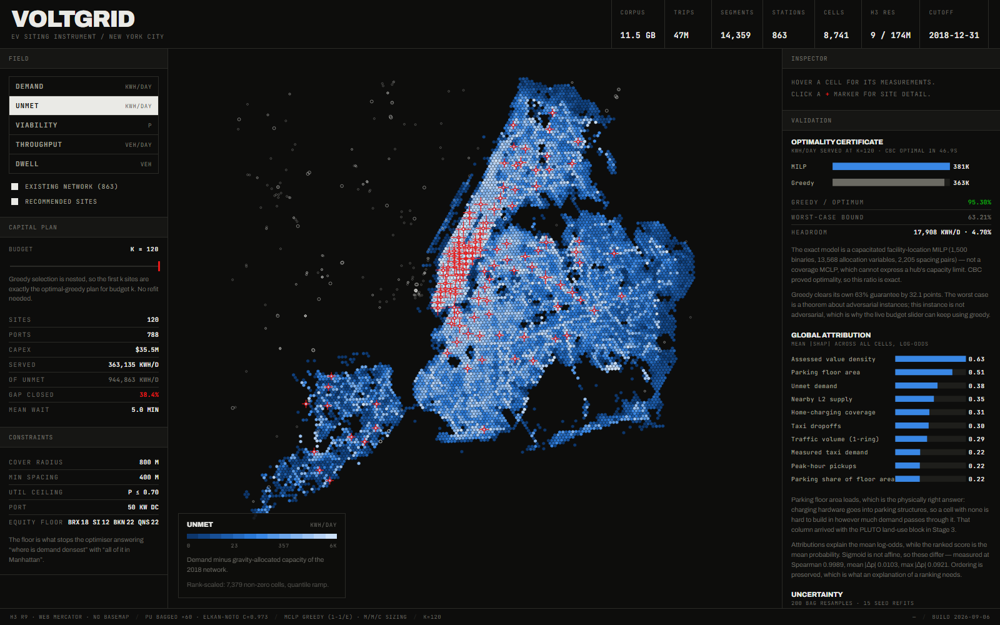

# VOLTGRID — EV charging infrastructure siting for New York City

An 18-stage pipeline that reads **11.5 GB** of municipal mobility, traffic and land-use records and produces a costed, constraint-satisfying list of new EV charging sites — plus a dashboard built for defending that list in a public hearing.

The output for a 120-site programme: **788 ports, $35.5M, 38.4% of unmet demand served, 5.0 min mean queue wait**, on a plan that respects Con Edison's published grid headroom and a per-borough accessibility floor.



*Live at [ev-fortisi.vercel.app](https://ev-fortisi.vercel.app). The field is the measured unmet-demand surface across 8,741 H3 cells; red crosshairs are the 120 recommended sites. Every number on screen is regenerated by the pipeline — nothing is mocked.*

---

## Why not just classify each cell?

The obvious approach — label every map cell "station / no station" and fit a classifier — fails four ways, and each failure shaped the architecture:

| Problem | Why it breaks | What this project does |
|---|---|---|
| **Circularity** | Existing stations encode where operators *already* built. Maximising accuracy against them maximises conformity to the status quo and can never justify a new area. | Demand is measured independently, from 47.4M taxi trips and traffic counts, in physical units (kWh/day). |
| **Positive-Unlabeled** | A cell without a charger is *unbuilt*, not unsuitable. Treating unlabeled as negative destroys calibration. | Bagged PU learning (Mordelet–Vert) with Elkan–Noto calibration. |
| **Spatial leakage** | Adjacent cells share features, so random k-fold inflates scores badly. | Spatial block CV, reported *next to* naive k-fold so the inflation is visible (+0.49 R²). |
| **Ranking ≠ planning** | The top-k cells cluster and cover the same demand repeatedly. | Capacitated maximal-covering optimisation over a *set*, with M/M/c queueing. |

So the model is a four-stage cascade: **demand → suitability → gap → allocation**.

---

## Results

Validation is deliberately unflattering. The headline is a **temporal forward test** — fit on the network as it stood at 2018-12-31 (219 positive cells), then check whether the model predicted where the 2019–21 build-out actually landed (190 of 8,522 candidates, a 2.2% base rate).

| Method | PR-AUC | P@100 | Lift |
|---|---|---|---|
| **PU model** | **0.173** | **33.0%** | **14.8×** |
| Distance to nearest station | 0.099 | 19.0% | 8.5× |
| Demand ranking | 0.097 | 23.0% | 10.3× |
| Traffic ranking | 0.058 | 9.0% | 4.0× |
| Random | 0.022 | 1.0% | 0.5× |

PR-AUC rather than ROC-AUC: at a 2.2% base rate ROC-AUC is dominated by the negative mass and flatters everything.

**Greedy allocation is certified at 95.3% of a CBC-proved optimum** (381,043 vs 363,135 kWh/day), far above its (1 − 1/e) ≈ 63.2% worst-case guarantee — which is what licenses using greedy behind the dashboard's live budget slider while the MILP serves as the audit path.

---

## Findings, including the ones that went against me

**Land use is what makes demand predictable.** On traffic features alone the demand model captured 22.4% of true energy in its top decile — *losing* to a trivial AADT ranking at 49.0%. Adding PLUTO built-environment features took it to **78.8%** against a 90.0% oracle ceiling. Parking floor area and assessed value density lead the SHAP attribution: whether there is physically anywhere to put the hardware is among the strongest predictors of where a charger actually got built.

**Siting does not transfer into NYC.** Cross-domain tests across Germany, German metros, NYC and Connecticut show that adding globally-consistent built form lifts transfers beating their target baseline from **5/12 to 9/12** — so network *shape* alone doesn't transfer, but built form largely does. The exception is absolute: **every transfer into NYC fails**, and Germany → NYC got *worse* with built form. NYC has the strongest trivial baseline of any domain. Do not pretrain elsewhere and deploy here.

**The grid is not the bottleneck — where data exists.** Con Edison's published substation headroom costs only 0.01–0.49% of served energy across programme sizes, and caps the pool at 338 sites against 354 unconstrained. But only 5,460 of 8,742 cells have published data and **Manhattan has none** (it runs on a secondary network system published separately). Absence of published capacity is not evidence of available capacity.

**26 of 120 sites exist only because of the equity floor** — established by re-running the optimiser without the floor and diffing, not inferred from low viability scores. A heuristic reading would have overstated it by nearly 2×.

**Metrics are quoted at the precision they support.** A 15-seed sweep puts PR-AUC at 0.173 ± 0.0028 (95% CI 0.166–0.175) and shows lift supports only **one** decimal — so "14.83×" was false precision. That same interval doubles as the drift-detection control limit: inside it is noise, outside is worth a human.

**77 of 120 sites are selected in every one of 200 bootstrap replicates; 3 are coin-flips.** A ranked list hides that distinction entirely.

---

## Data

| Source | Role | Volume |
|---|---|---|
| AFDC alternative fuel stations | labels + temporal validator (`Open Date` 99.86% populated) | 50,289 rows |
| NYC Yellow Taxi 2015-01, 2016-01…03 | demand signal | ~47.4M trips, 7.4 GB |
| NYC Automated Traffic Volume Counts | throughput + congestion | 14,359 segments, 3.3 GB |
| NYC MapPLUTO | built environment | 858,284 tax lots |
| ACS B25044 | vehicle availability | tract-level, allocated by residential units |
| Con Edison hosting capacity | substation headroom | 59,600 feeder records |
| JRC GHSL | globally-consistent built form, for transfer | ~90 m raster |
| BNetzA (Germany), AFDC-CT | transfer domains | 36,770 / 533 stations |

The five Kaggle-sourced datasets are expected under `data/raw/` (see [PLAN.md](PLAN.md) for the exact layout); the rest are fetched and cached automatically on first run. **`data/raw/` is gitignored** — 11.5 GB does not belong in version control.

---

## Running it

```bash
python run_pipeline.py                 # all 18 stages, ~23 min warm
python run_pipeline.py --only demand   # one stage
python run_pipeline.py --from features # from a stage onward
```

Dashboard:

```bash
cd dashboard && npm install && npm run dev
```

Requires Python 3.13 with `duckdb h3 lightgbm pulp pandas numpy scikit-learn pyarrow shapely pyproj rasterio`, and Node 20.

The first run downloads ~1 GB of GHSL raster tiles and takes ~3 h; every run after is ~23 min against the OS page cache.

---

## Layout

```
src/evopt/
  ingest/     stations · mobility · traffic · landuse · acs · ghsl · feeders
  models/     demand · suitability · allocate · certify · explain · uncertainty · transfer
  features.py surface.py geo.py export.py drift.py
dashboard/    Vite + React + TypeScript, custom canvas H3 renderer
reports/      every metric this README quotes, regenerated each run
scripts/      check_reports.py — asserts PLAN.md matches reports/
```

The dashboard renders its own vector geometry: **no tile server, no basemap, and no third-party request of any kind** — fonts are self-hosted, and CI fails the build if an external URL appears in `dist/`. It is meant to run on an isolated operations-room machine.

---

## Limitations

- Taxi trips are a biased sample of the fleet, concentrated in Manhattan; outer-borough demand is the weaker estimate.
- The 2015–16 mobility window predates both the pandemic and the TLC electrification mandate. It measures *structure* — where trips terminate and vehicles dwell — which is more stable than volume, but it is not current.
- Cost is a flat $45k/port. Real siting cost is dominated by electrical service upgrades and varies by an order of magnitude.
- No parcel-level feasibility: a recommended cell is 0.105 km², and whether a specific lot inside it is available, zoned and connectable is out of scope.
- **The model is NYC-specific.** Nothing transfers in. Refit before using it anywhere else.

Full methodology, per-stage rationale and the complete transfer matrices are in **[PLAN.md](PLAN.md)**. Design decisions for the interface are in [DESIGN.md](DESIGN.md) and [PRODUCT.md](PRODUCT.md).
